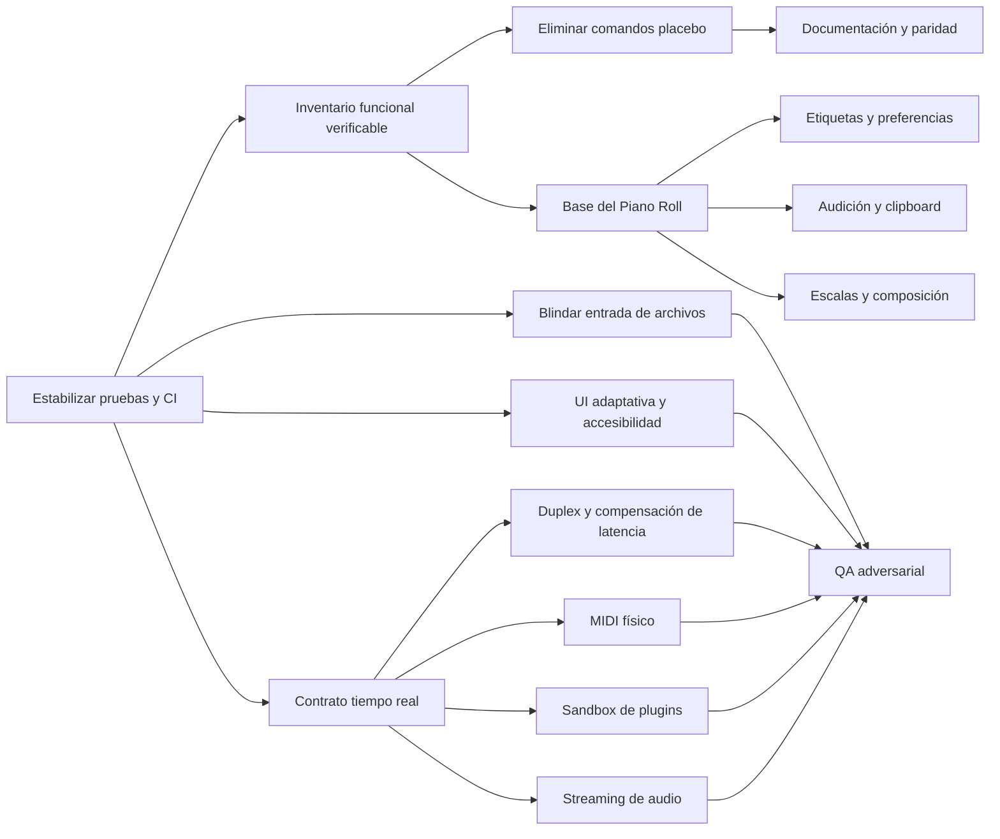

# SoundCraft — Plan maestro de corrección y evolución

**Estado:** ejecución en curso; la tabla de estado distingue lo completado, parcial y pendiente
**Fecha de corte:** 2026-10-17
**Rama auditada:** `feature/miscellaneous-adjustments-panconquesito`
**Base declarada:** `origin/main`
**Ámbito:** corrección de fallos, reducción de riesgos, mejoras UX/UI, Piano Roll, audio/MIDI, seguridad, rendimiento, pruebas y distribución
**Autoridad de evidencia:** inspección del repositorio y comandos ejecutados durante la auditoría; las hipótesis están marcadas como tales

## Estado de ejecución

| Iniciativa | Estado al 2026-10-17 | Evidencia de avance |
|---|---|---|
| SC-001 | Completada localmente | Comparación semántica de rutas; regresión Windows aprobada |
| SC-002 | Implementada y validada localmente; pendiente del primer runner alojado | `.github/workflows/ci.yml` ejecuta `cargo xtask ci` en Linux/macOS/Windows; todos los gates locales aprobaron. El gate serializa funciones de prueba para evitar `STATUS_INVALID_HANDLE` del harness UI paralelo en Windows |
| SC-003 | Infraestructura completada; clasificación profunda continúa | `CapabilityStatus`, evidencia en `engine.commands`, `cargo xtask capabilities` y documento generado |
| SC-004 | Parcial | Freeze no simula render; Renumber Bars queda explícitamente deshabilitado; faltan los demás comandos superficiales y Freeze real |
| SC-005 | Primera barrera completada | Límites previos a lectura/reserva para archivos en memoria, texto de sesión y bundles; falta fuzzing ampliado |
| SC-006 | Completada para contradicciones conocidas | Roadmaps y documentos de arquitectura/hardware corregidos |
| SC-010 | Completada localmente | Viewport testeable, zoom horizontal al cursor, zoom vertical, paneo, scroll lateral, controles −/Fit/+ y altura explícita/persistente del panel; render offscreen verificado |
| SC-012 | Completada localmente | Comandos de copiar/cortar/pegar/duplicar notas, clipboard relativo, límites, undo atómico y atajos contextuales verificados |
| SC-013 | Completada localmente | Etiquetas off/roots/all, inglés/español, sostenidos/bemoles, caché y persistencia; render offscreen 1600×1000 verificado |
| SC-014 | Parcial avanzada | Índice intervalar por bloques cacheado por revisión, render/hit-test/velocidad limitados al rango temporal visible y filtro de pitch; equivalencia contra búsqueda lineal verificada con 100k notas. Falta profiling/repaint con umbrales |
| SC-017 | Parcial: barra y menú principal completados | Transporte/posición fijos, acciones secundarias en overflow y menú principal colapsable; renders 960×600, 480×300 puntos y 1600×900 verificados. Falta política adaptativa de paneles laterales |
| SC-023 | Base parcial implementada | Selector persistente de 7 idiomas, catálogo tipado con fallback inglés, superficies críticas iniciales y fuente japonesa del sistema; falta migración integral y revisión nativa |
| SC-007–SC-009, SC-011, SC-015–SC-016, SC-018–SC-022, SC-024–SC-026 | Pendiente | — |

## 1. Objetivo y reglas de ejecución

Este documento convierte los hallazgos de la auditoría en un plan implementable y verificable. Cada iniciativa incluye evidencia, alcance, solución, dependencias, riesgos, criterios de aceptación y pruebas requeridas.

Reglas obligatorias para ejecutar el plan:

1. No cambiar de rama ni sobrescribir cambios existentes.
2. Implementar por incrementos pequeños, revisables y reversibles.
3. Mantener el principio **never crash** y las restricciones de tiempo real del callback de audio.
4. No incorporar activos o implementaciones propietarias de otros DAW.
5. Mantener la arquitectura por capas y el modelo “todo comportamiento visible es un comando”.
6. No considerar completada una función porque exista una entrada de menú o una bandera de estado.
7. Acompañar cada corrección de regresión con una prueba automatizada cuando sea técnicamente posible.
8. No afirmar mejoras de rendimiento sin medición antes/después.
9. Ejecutar `cargo xtask ci` antes de integrar cada arco de trabajo.
10. Actualizar `ROADMAP.md`, `docs/gaps.md` y los documentos de paridad cuando cambie el estado real de una capacidad.

## 2. Línea base verificada

| Área | Resultado observado | Estado |
|---|---|---|
| Formato | `cargo fmt --all -- --check` | Aprobado |
| Compilación | `cargo check --workspace --locked --offline` | Aprobado |
| Lints | `cargo clippy --workspace --all-targets --locked --offline -- -D warnings` | Aprobado |
| Capas | `cargo xtask layers` | Aprobado |
| Activos | `cargo xtask assets` | Aprobado |
| Pruebas | `cargo test -j 2 --workspace -- --test-threads=1`: suite completa, integraciones y doctests aprobados; un benchmark de velocidad permanece `ignored` por diseño | Aprobado |
| WASM | `cargo xtask wasm`, después de instalar el target oficial `wasm32-unknown-unknown` requerido por el repositorio | Aprobado |
| Mezcla | 64 pistas × 10 s, EQ + compresor en todas y reverb en 1/4: 1,81 s; 5,5× tiempo real | Medición de referencia, no SLA |
| UI 1600×1000 | Interfaz densa y operable | Verificación visual offscreen |
| UI 960×600 | Transporte, posición y overflow permanecen visibles; los paneles laterales aún reducen el lienzo | Barra corregida; paneles pendientes |
| Vulnerabilidades | `cargo-audit` y `cargo-deny` no estaban disponibles | No verificado |

Notas de interpretación:

- Un resultado “aprobado” solo aplica al comando y entorno indicados.
- El benchmark de mezcla sirve como línea base local; no permite extrapolar rendimiento a otros equipos.
- La ausencia de hardware MIDI, interfaces dedicadas y plugins comerciales limita la validación de integración.
- En Windows, las pruebas unitarias e integraciones de `soundcraft-ui-egui` aprobaron en serie. El harness paralelo terminó reproduciblemente con `STATUS_INVALID_HANDLE` mientras dos pruebas estaban en vuelo; `cargo xtask ci` fuerza `--test-threads=1` hasta aislar el recurso global causante.
- La ejecución inicial de `cargo xtask ci` dentro del sandbox confirmó formato y Clippy, pero cinco pruebas de la aplicación de escritorio recibieron errores de permiso del entorno (`os error 5/10013`). La suite completa ejecutada fuera del sandbox aprobó; no se atribuyó ese bloqueo a SoundCraft.

## 3. Prioridad y estados de evidencia

### Prioridad

- **P0 — Crítico:** corrupción o pérdida de datos, fallo de seguridad grave, bloqueo o incumplimiento directo del contrato de tiempo real.
- **P1 — Alto:** función principal engañosa/inoperante, obstáculo severo de flujo o riesgo importante de estabilidad.
- **P2 — Medio:** mejora relevante de productividad, rendimiento, mantenibilidad o accesibilidad.
- **P3 — Bajo:** refinamiento, función opcional o mejora visual no bloqueante.

### Evidencia

- **CONFIRMADO:** demostrado mediante código, prueba o reproducción.
- **PROBABLE:** evidencia fuerte, pendiente de reproducción completa.
- **POTENCIAL:** riesgo técnico fundamentado que requiere instrumentación o entorno específico.
- **NO VERIFICADO:** no fue posible comprobarlo con el entorno disponible.

## 4. Dependencias del plan

## 5. Backlog detallado

### SC-001 — Corregir la prueba de confianza de rutas en Windows

- **Categoría:** QA / portabilidad.
- **Prioridad:** P1.
- **Evidencia:** CONFIRMADO.
- **Ubicación:** `crates/engine/src/io.rs`, prueba `saved_audio_is_trusted_only_in_the_folder_it_was_saved_in` alrededor de la línea 1613.
- **Problema:** la expectativa construye una ruta con separadores mixtos mediante `join("Audio Files/Audio 1_02.wav")`, mientras que Windows normaliza la ruta resultante con `\`. El comportamiento productivo no quedó demostrado como defectuoso; el fallo está en una aserción dependiente de representación textual.
- **Impacto de usuario:** indirecto; impide confiar en una suite verde y puede ocultar regresiones reales.
- **Impacto técnico:** bloquea el gate completo en Windows.
- **Solución:** comparar rutas semánticamente con `Path`/`PathBuf`; si se compara una cadena serializada, normalizar de forma explícita solo en el límite de serialización. Agregar casos para ruta dentro del directorio confiable, ruta hermana, traversal `..` y diferencias de separador.
- **Componentes:** `soundcraft-engine` / persistencia de audio.
- **Complejidad:** XS, 0,5–1 día.
- **Riesgos:** enmascarar un error real si se normalizan rutas demasiado pronto.
- **Dependencias:** ninguna.
- **Criterios de aceptación:**
  1. La prueba pasa en Windows, Linux y macOS sin `cfg` que omita la validación.
  2. Una ruta fuera de la carpeta guardada continúa sin ser marcada como confiable.
  3. La comparación conserva la política de seguridad original.
- **Pruebas:** unitarias multiplataforma; `cargo test -p soundcraft-engine saved_audio_is_trusted_only_in_the_folder_it_was_saved_in`; suite workspace.

### SC-002 — Crear un CI general obligatorio por cambio

- **Categoría:** DevOps / calidad.
- **Prioridad:** P1.
- **Evidencia:** CONFIRMADO en el repositorio; no se observó un workflow general para cada PR. Las protecciones externas del repositorio no fueron verificadas.
- **Problema:** existen workflows especializados, pero no queda garantizado en el repositorio que cada PR ejecute formato, Clippy, pruebas, capas y activos.
- **Impacto de usuario:** reduce la probabilidad de fallos en builds entregados.
- **Impacto técnico:** evita integrar regresiones como SC-001.
- **Solución:** workflow para `pull_request` y ramas principales, con caché de Cargo, `cargo xtask ci`, matriz mínima Windows/Linux y chequeo WASM según soporte. Separar tareas rápidas de las costosas para feedback temprano.
- **Componentes:** `.github/workflows/`, `xtask`.
- **Complejidad:** S, 1–2 días.
- **Riesgos:** tiempos de CI, diferencias de toolchain, límites de runners.
- **Dependencias:** SC-001 para lograr línea base verde.
- **Criterios de aceptación:**
  1. Cada PR ejecuta gates reproducibles.
  2. Fallos se muestran por gate, no como un único job opaco.
  3. El toolchain y `Cargo.lock` quedan fijados.
  4. No se descargan ni redistribuyen activos incompatibles.
- **Pruebas:** ejecución real en PR de prueba; fallo intencional controlado en fork/rama temporal; verificación de caché.

### SC-003 — Generar inventario funcional desde el registro de comandos

- **Categoría:** arquitectura / producto / documentación.
- **Prioridad:** P1.
- **Evidencia:** CONFIRMADO: el proyecto mide amplitud de menús, pero una entrada registrada no demuestra profundidad funcional.
- **Problema:** comandos completos, superficiales y de solo bandera pueden contabilizarse como paridad equivalente.
- **Impacto de usuario:** expectativas incorrectas y dificultad para saber qué flujo es realmente utilizable.
- **Impacto técnico:** priorización basada en conteo, no en capacidad verificable.
- **Solución:** extender metadatos del comando con un estado auditable: `complete`, `limited`, `partial`, `ui_only`, `unsupported`, `not_verified`; incluir nivel de prueba y enlace a issue/gap. Generar una tabla desde el registro, nunca mantenerla a mano.
- **Componentes:** `crates/engine/src/cmd/`, catálogo, `xtask`, documentos de paridad.
- **Complejidad:** M, 3–5 días.
- **Riesgos:** burocracia si el estado no se actualiza con código.
- **Dependencias:** SC-001, SC-002.
- **Criterios de aceptación:**
  1. Todos los comandos visibles tienen estado y evidencia.
  2. La métrica separa amplitud de profundidad.
  3. CI falla si se registra un comando sin clasificación.
  4. El reporte identifica comandos con interfaz pero sin efecto musical.
- **Pruebas:** snapshot del catálogo, validación de esquema, prueba de comando sin metadata.

### SC-004 — Eliminar o completar comandos que simulan capacidad

- **Categoría:** lógica funcional / UX.
- **Prioridad:** P1.
- **Evidencia:** CONFIRMADO para `track.freeze` y `event.renumber_bars`; PROBABLE para otras opciones de configuración detectadas como almacenamiento de bandera.
- **Problema:** algunas acciones cambian estado o devuelven un mensaje sin ejecutar el comportamiento esperado.
- **Ejemplos confirmados:**
  - `crates/engine/src/cmd/track.rs`: `track.freeze` alterna `Track::frozen`, pero no renderiza ni sustituye procesamiento.
  - `crates/engine/src/cmd/event.rs`: `event.renumber_bars` devuelve `{"note":"bars start at 1"}`.
- **Solución general:** cada comando debe seguir una de cuatro rutas: implementación completa, implementación limitada declarada, deshabilitado con explicación, o retirada temporal de la UI. Nunca conservar un éxito aparente sin efecto.
- **Subplan `track.freeze`:**
  1. Definir semántica: render prefader/post-insert, colas de efectos, automatización y routing.
  2. Renderizar a archivo temporal versionado mediante el motor offline compartido.
  3. Conservar cadena original y estado para “Unfreeze”.
  4. Cambiar la reproducción a fuente congelada solo tras escritura atómica exitosa.
  5. Invalidar el freeze al cambiar clips, plugins, routing o parámetros relevantes.
  6. Recuperar sin corrupción ante cierre durante render.
- **Subplan `event.renumber_bars`:**
  1. Diseñar un mapa de numeración separado del tiempo musical interno.
  2. Validar solapamientos, rangos negativos y cambios de compás.
  3. Integrar regla, transporte, marcadores, exportación e undo.
  4. Si este modelo no se implementa aún, deshabilitar el comando con estado `unsupported`.
- **Otras opciones a auditar:** low-latency monitoring, MIDI Studio/Beat Clock, transcripción y destructive punch.
- **Componentes:** engine commands, model, mix, playback, UI, persistence.
- **Complejidad:** L para auditoría; XL para freeze completo.
- **Riesgos:** pérdida de edición original, archivos huérfanos, discrepancia entre playback y bounce.
- **Dependencias:** SC-003, SC-007 para freeze seguro.
- **Criterios de aceptación:**
  1. Ningún comando clasificado “completo” se limita a cambiar una bandera sin efecto observable.
  2. Freeze reduce procesamiento medido y produce salida equivalente dentro de tolerancia definida.
  3. Unfreeze restaura el grafo editable.
  4. Renumeración se refleja de forma consistente o el comando aparece explícitamente no soportado.
- **Pruebas:** catálogo contrato/efecto, round-trip freeze/unfreeze, cancelación, disco lleno, undo/redo, bounce diferencial.

### SC-005 — Limitar archivos hostiles antes de reservar memoria

- **Categoría:** seguridad / resiliencia.
- **Prioridad:** P0.
- **Evidencia:** POTENCIAL, sustentada por `MAX_IMPORT_SAMPLES = 1 << 30` en `crates/engine/src/io.rs` y límites tardíos de lectura/decodificación.
- **Problema:** un archivo grande o malformado puede provocar reserva excesiva antes de que actúen los límites semánticos.
- **Impacto de usuario:** posible cierre por agotamiento de memoria o degradación extrema al abrir/importar.
- **Solución:**
  1. Consultar tamaño físico antes de leer cuando la fuente sea seekable.
  2. Aplicar límites separados para proyecto, entrada comprimida, audio decodificado, número de entradas y metadatos.
  3. Usar lectura acotada/streaming en lugar de `read_to_end` sin techo.
  4. Validar sumas y multiplicaciones con aritmética checked/saturating antes de reservar.
  5. Rechazar relaciones de compresión sospechosas y tamaños declarados incoherentes.
  6. Producir errores tipados y accionables, no panic.
- **Componentes:** `engine/io.rs`, `audio-io`, MIDI, bundles de proyecto.
- **Complejidad:** M, 4–7 días.
- **Riesgos:** límites demasiado restrictivos para proyectos legítimos.
- **Dependencias:** SC-001/002.
- **Criterios de aceptación:**
  1. Ningún importador reserva memoria según valores no validados.
  2. Los límites son configurables o documentados.
  3. Archivos sobredimensionados fallan antes de la decodificación completa.
  4. El proyecto abierto permanece intacto tras el error.
- **Pruebas:** fuzz/property tests, cabeceras truncadas, tamaños máximos, zip bomb simulada, MIDI con conteos extremos, medición de pico de memoria.

### SC-006 — Corregir documentación y métricas de paridad obsoletas

- **Categoría:** documentación / producto.
- **Prioridad:** P1.
- **Evidencia:** CONFIRMADO: documentos describen capacidades de audio/sampler de forma no totalmente alineada con el código actual.
- **Problema:** la documentación puede indicar que una capacidad no existe cuando sí hay implementación parcial, o viceversa.
- **Solución:** realizar revisión código-documento por dominio; para cada afirmación agregar estado, evidencia y fecha. Generar automáticamente lo derivable del catálogo y mantener manual solo evaluación cualitativa.
- **Componentes:** `ROADMAP.md`, `docs/architecture.md`, `docs/gaps.md`, documentos de paridad.
- **Complejidad:** S, 1–3 días iniciales; mantenimiento continuo.
- **Riesgos:** volver a quedar obsoleto si no se integra en CI/Definition of Done.
- **Dependencias:** SC-003/004.
- **Criterios de aceptación:** no existen contradicciones conocidas entre sampler, grabación a disco, elección de dispositivo/buffer y estado declarado.
- **Pruebas:** revisión cruzada por responsable de cada crate; enlace de cada afirmación a comando/prueba.

### SC-007 — Sacar trabajo no determinista del callback de audio

- **Categoría:** audio en tiempo real / concurrencia.
- **Prioridad:** P0.
- **Evidencia:** CONFIRMADO para la existencia de operaciones potencialmente asignadoras durante sincronización; POTENCIAL para dropout observable sin hardware/profiling dedicado.
- **Ubicación:** `crates/playback/src/lib.rs` procesa comandos y llama `ensure_synced`; `crates/mix/src/lib.rs` documenta y ejecuta sincronización que puede asignar.
- **Problema:** cambios estructurales durante reproducción pueden redimensionar vectores, reconstruir estado, insertar en mapas o enviar recursos por canales no diseñados como parte del contrato RT.
- **Arquitectura propuesta:**
  1. Construir un `PreparedMix` inmutable fuera del hilo de audio.
  2. Precalcular buffers, rutas, voces, plugins y medidores en el hilo de control.
  3. Publicar snapshots mediante SPSC/atomic swap de capacidad fija.
  4. En el callback, limitarse a lectura, DSP acotado y swap O(1).
  5. Retirar snapshots viejos en un hilo no RT mediante una cola de retiro preasignada.
  6. Definir política cuando la cola está llena: conservar snapshot actual y reportar telemetría; nunca bloquear.
  7. Prohibir explícitamente asignación, mutex, I/O, logging, destrucción costosa y `send` potencialmente bloqueante en RT.
- **Componentes:** playback, mix, engine, plugin hosts, meters.
- **Complejidad:** XL, 3–6 semanas.
- **Riesgos:** divergencia de estado UI/audio, lifetime de plugins, picos al publicar cambios grandes.
- **Dependencias:** SC-002; precede a SC-008, SC-016, SC-020 y SC-021.
- **Criterios de aceptación:**
  1. Instrumentación demuestra cero asignaciones en steady state y durante swap soportado.
  2. El callback no adquiere locks ni realiza I/O.
  3. Cambios rápidos de estructura no bloquean el callback.
  4. Playback y bounce siguen usando semántica de mezcla equivalente.
  5. Toda violación del contrato RT queda cubierta por test o detector.
- **Pruebas:** allocator contador en tests, estrés de comandos durante reproducción, ThreadSanitizer donde sea viable, soak test, comparación sample a sample/tolerancia.

### SC-008 — Implementar duplex, selección de canales y compensación de latencia

- **Categoría:** audio I/O / grabación.
- **Prioridad:** P1.
- **Evidencia:** CONFIRMADO: entrada y salida usan streams/relojes separados; faltan mapeo completo y compensación verificable.
- **Problema:** la grabación puede quedar desplazada y la experiencia varía según driver/dispositivo.
- **Solución:**
  1. Modelar `AudioDeviceConfig` persistible con host, input, output, sample rate, buffer y canales.
  2. Preferir stream duplex cuando el backend lo permita.
  3. Para relojes separados, estimar drift y aplicar estrategia documentada de sincronización.
  4. Medir latencia reportada de entrada/salida y permitir offset manual calibrado.
  5. Aplicar compensación al colocar el clip grabado, sin modificar el audio original.
  6. Manejar hot-plug y pérdida de dispositivo con transición segura.
- **Componentes:** playback, audio I/O, UI setup, model/persistence.
- **Complejidad:** XL, 3–5 semanas.
- **Riesgos:** diferencias CPAL/ASIO/CoreAudio/ALSA, relojes no sincronizados, feedback.
- **Dependencias:** SC-007.
- **Criterios de aceptación:** selección efectiva de dispositivo/canales/buffer; round-trip dentro de tolerancia definida; recuperación segura ante desconexión.
- **Pruebas:** loopback físico por backend, cambio de sample rate, pérdida de dispositivo, buffer mínimo/máximo, grabación prolongada y drift.

### SC-009 — Resampling con calidad seleccionable y contrato explícito

- **Categoría:** DSP / importación.
- **Prioridad:** P2.
- **Evidencia:** CONFIRMADO para conversión existente; calidad perceptual y aliasing no cuantificados.
- **Problema:** una única estrategia puede ser insuficiente para importación final o costosa para previsualización.
- **Solución:** perfiles `Draft`, `Realtime` y `High`; API sin asignación en RT para el modo realtime; respuesta y latencia documentadas; conversión offline de alta calidad para import/bounce.
- **Componentes:** audio-io, engine IO, mix/bounce.
- **Complejidad:** M, 1–2 semanas.
- **Riesgos:** cambio de sonido, mayor latencia/CPU, licencia de dependencia externa.
- **Dependencias:** SC-005; evaluar dependencia antes de incorporarla.
- **Criterios de aceptación:** tests de frecuencia/aliasing, salida determinista por perfil, UI informa el modo aplicado.
- **Pruebas:** barridos sinusoidales, impulsos, ratios comunes/no enteros, golden files propios.

### SC-010 — Navegación y zoom completos del Piano Roll

- **Categoría:** Piano Roll / UX.
- **Prioridad:** P1.
- **Estado de implementación:** COMPLETADA LOCALMENTE. Incluye viewport, zoom/pan, navegación, menú de altura con presets, resize libre del dock, persistencia y borrado directo de una nota con clic derecho/undo.
- **Evidencia:** CONFIRMADO en `crates/ui-egui/src/midi_editor.rs`: `ROW_H = 9`, `KEY_W = 48`, escala horizontal ajustada al clip completo y scroll vertical únicamente.
- **Problema:** clips largos se comprimen; no existe una navegación horizontal productiva ni zoom legible.
- **Solución:**
  1. Crear `MidiViewport { start_tick, ticks_per_pixel, lowest_pitch, row_height }`.
  2. Separar conversión coordenada↔tiempo/nota en funciones puras testeables.
  3. Incorporar zoom horizontal centrado en cursor y vertical centrado en nota.
  4. Añadir barras/pan con middle drag y atajos consistentes con el editor principal.
  5. Adaptar densidad de grid y etiquetas según zoom.
  6. Persistir viewport por clip o editor sin contaminar el documento musical.
- **Componentes:** `ui-egui/midi_editor.rs`, estado UI.
- **Complejidad:** M, 1–2 semanas.
- **Riesgos:** pérdida de precisión, conflictos de gesto, saltos al redimensionar.
- **Dependencias:** ninguna, pero conviene antes de SC-013/014.
- **Criterios de aceptación:** clips de minutos pueden editarse a nivel de nota; el punto bajo cursor permanece estable al hacer zoom; resize no pierde contexto.
- **Pruebas:** conversiones round-trip, DPI 100–250%, 960×600 y ultrawide, gestos y teclado.

### SC-011 — Audición de notas y ruta MIDI en vivo

- **Categoría:** Piano Roll / MIDI / audio RT.
- **Prioridad:** P1.
- **Evidencia:** CONFIRMADO: comentario en `midi_editor.rs` indica que la audición no está implementada y necesita una ruta MIDI en vivo.
- **Problema:** dibujar o seleccionar notas no proporciona feedback sonoro inmediato.
- **Solución:**
  1. Definir eventos `PreviewNoteOn/Off` con nota, velocidad, canal, destino y token de voz.
  2. Encolar en SPSC preasignada hacia playback.
  3. Resolver destino en snapshot preparado, no en callback.
  4. Garantizar `NoteOff` en mouse-up, pérdida de foco, cambio de pista, stop y cierre.
  5. Limitar duración y número de voces de preview para evitar notas colgadas.
  6. Añadir preferencia de audición y volumen.
- **Componentes:** UI, engine/playback, mix, instrumentos.
- **Complejidad:** M, 1–2 semanas.
- **Riesgos:** notas colgadas, doble disparo, carrera al cambiar de instrumento.
- **Dependencias:** SC-007; comparte infraestructura con SC-016.
- **Criterios de aceptación:** clic/arrastre produce nota correcta; nunca quedan voces activas después de cancelar/cerrar; la ruta no asigna en callback.
- **Pruebas:** secuencias de foco, cancelación, cambio de pista, ráfagas, contador de voces.

### SC-012 — Clipboard MIDI, duplicación y edición por comandos

- **Categoría:** Piano Roll / productividad.
- **Prioridad:** P1.
- **Evidencia:** CONFIRMADO: no se encontró flujo dedicado de copiar/pegar/duplicar notas en la implementación actual del editor MIDI.
- **Problema:** operaciones básicas requieren recrear notas manualmente.
- **Solución:**
  1. Representar clipboard interno con notas relativas a ancla temporal y pitch base.
  2. Implementar comandos engine `midi.notes.copy`, `cut`, `paste`, `duplicate` y no lógica exclusiva de UI.
  3. Definir paste al cursor/playhead/selección y snap.
  4. Agrupar cada operación en una sola transacción undo.
  5. Validar pitch 0–127, tick y longitud con aritmética segura.
  6. Considerar clipboard del sistema solo con un formato abierto/documentado, no como requisito inicial.
- **Componentes:** engine commands, model MIDI, UI, undo.
- **Complejidad:** M, 1–2 semanas.
- **Riesgos:** offsets ambiguos, pegado fuera de clip, undo fragmentado.
- **Dependencias:** SC-003 y modelo estable del viewport.
- **Criterios de aceptación:** selección múltiple conserva intervalos, duración y velocidad; duplicar es una acción atómica; paste nunca crea datos inválidos.
- **Pruebas:** bordes MIDI, tiempo negativo, clip vacío, varias pistas, undo/redo repetido.

### SC-013 — Etiquetas de todas las notas en inglés/español

- **Categoría:** Piano Roll / accesibilidad / internacionalización.
- **Prioridad:** P1.
- **Evidencia:** CONFIRMADO: actualmente solo se etiqueta la clase C y `soundcraft_midi::note_name` usa nombres ingleses con sostenidos; la convención verificada es MIDI 60 = C3.
- **Objetivo funcional:** permitir mostrar/ocultar todos los nombres, elegir inglés o español, elegir sostenidos/bemoles, conservar MIDI/octava exactos y persistir preferencias.
- **Modelo propuesto:**
  - `NoteNamingSystem`: `English`, `Spanish`.
  - `AccidentalStyle`: `Sharps`, `Flats`, `Auto`.
  - `KeyboardLabelMode`: `Off`, `Roots`, `All`.
  - Convención de octava central separada de traducción; el valor por defecto debe conservar MIDI 60 = C3.
- **Solución:**
  1. Trasladar formateo musical puro a `soundcraft-midi`, parametrizado por preferencias.
  2. Mantener tablas exactas: `C/C♯/D...` y `Do/Do♯/Re...`; para bemoles usar equivalentes correctos (`D♭`, `E♭`, etc.).
  3. No alterar pitch MIDI, afinación ni datos del clip; solo presentación.
  4. Guardar preferencias en estado/configuración de usuario, no en sesión salvo que se decida compartir vista.
  5. Hacer render adaptativo: abreviar u ocultar octava cuando el ancho/alto no permita lectura.
  6. Cachear texto/galley por combinación de nota, estilo y DPI para evitar coste por frame.
  7. Añadir menú accesible en Piano Roll y atajo opcional para alternar etiquetas.
- **Archivos previstos:** `crates/midi/src/names.rs`, `crates/ui-egui/src/midi_editor.rs`, definición/persistencia de preferencias UI y menú de editor.
- **Complejidad:** M, 4–7 días.
- **Riesgos:** bemolización contextual incorrecta en `Auto`; saturación visual con `ROW_H` pequeño.
- **Dependencias:** SC-010 para legibilidad; SC-023 para infraestructura general de idioma, aunque puede implementarse antes con enums locales.
- **Criterios de aceptación:**
  1. Las 128 notas conservan correspondencia exacta con MIDI.
  2. MIDI 60 se muestra `C3` o `Do3` según preferencia.
  3. Sostenidos y bemoles se alternan sin cambiar el pitch.
  4. Activar/desactivar etiquetas no afecta edición ni audio.
  5. Preferencia sobrevive reinicio.
  6. No hay texto ilegible/solapado en zoom mínimo; se degrada a modo reducido.
- **Pruebas:** tabla exhaustiva 0–127 × idioma × accidental; snapshots visuales por DPI/zoom; round-trip de configuración; benchmark con labels activas/inactivas.

### SC-014 — Virtualizar y acelerar el Piano Roll

- **Categoría:** rendimiento UI.
- **Prioridad:** P1.
- **Estado de implementación:** PARCIAL AVANZADA. `MidiNoteIndex` mantiene máximos de fin por bloques de 256 notas y se reconstruye solo al cambiar clip/revisión. Dibujo, hit-test, rubber-band y carril de velocidad reutilizan un scratch buffer con los solapamientos horizontales; el render filtra además el pitch visible. Una prueba de 100.000 notas compara 64 consultas contra búsqueda lineal exacta. Falta medir repaint/FPS y fijar umbrales reproducibles antes de declararla completa.
- **Evidencia:** CONFIRMADO para complejidad lineal: dibujo, hit-test inverso y búsquedas de velocidad recorren notas; POTENCIAL para caída perceptible con miles de notas.
- **Problema:** coste O(N) por frame/gesto aunque la mayoría de notas no sea visible.
- **Solución:**
  1. Mantener notas ordenadas por `start` y consultar rango temporal visible por búsqueda binaria.
  2. Filtrar pitch visible después del rango temporal.
  3. Construir índice espacial transitorio por viewport para hit-test.
  4. Invalidar el índice solo al editar o cambiar viewport.
  5. Dibujar únicamente grid y notas visibles.
  6. Evitar clonaciones para selección/hover.
- **Componentes:** modelo MIDI si se requiere índice reusable; UI editor.
- **Complejidad:** M/L, 1–3 semanas.
- **Riesgos:** índice desactualizado, orden alterado por edición, mayor memoria.
- **Dependencias:** SC-010.
- **Criterios de aceptación:** coste proporcional a elementos visibles; hit-test correcto después de mover/redimensionar; métricas reproducibles con 1k/10k/100k notas.
- **Pruebas:** benchmarks criterion o harness propio, property tests índice↔búsqueda lineal, perfiles de repaint.

### SC-015 — Herramientas musicales de composición

- **Categoría:** Piano Roll / producto.
- **Prioridad:** P2.
- **Evidencia:** brecha funcional CONFIRMADA respecto al alcance declarado; prioridad debe validarse con usuarios.
- **Alcance incremental:**
  1. Nota bajo cursor y estado de selección claro.
  2. Resaltado de escala/tonalidad sin modificar notas.
  3. Fold to scale y fold to used notes.
  4. Nombres de batería por mapa configurable.
  5. Herramienta de acordes basada en intervalos explícitos.
  6. Strum/humanize con semilla persistible y undo.
  7. Carriles CC editables.
  8. MPE como iniciativa separada y posterior.
- **Componentes:** midi, engine commands, UI, preferencias.
- **Complejidad:** XL como conjunto; dividir en historias S/M.
- **Riesgos:** comportamiento “mágico”, teoría musical rígida, edición destructiva accidental.
- **Dependencias:** SC-010 a SC-014.
- **Criterios de aceptación:** cada herramienta muestra preview o alcance antes de aplicar; es deshacible; no cambia notas fuera de selección.
- **Pruebas:** escalas mayores/menores/modales, enharmonía, bordes MIDI, determinismo de humanize.

### SC-016 — Añadir capa de MIDI físico

- **Categoría:** arquitectura / hardware MIDI.
- **Prioridad:** P1.
- **Evidencia:** CONFIRMADO: no existe dependencia/capa equivalente a `midir`; las opciones detectadas almacenan configuración pero no controlan dispositivos físicos.
- **Problema:** grabación/control MIDI externo no es una capacidad end-to-end verificable.
- **Solución:**
  1. Crear crate L0 `soundcraft-midi-io` sin dependencia de UI.
  2. Abstraer enumeración, apertura, hot-plug, timestamps y puertos virtuales donde el SO lo permita.
  3. Traducir entrada a eventos internos con tiempo monotónico.
  4. Encolar a playback/recording por estructuras lock-free acotadas.
  5. Implementar filtros, canales, thru, clock y panic/all-notes-off gradualmente.
  6. Persistir identificadores estables con fallback cuando desaparece el dispositivo.
- **Componentes:** nuevo crate, playback, engine, UI setup, automation/control.
- **Complejidad:** XL, 4–8 semanas.
- **Riesgos:** diferencias de backend, jitter, nombres no estables, desconexión durante grabación.
- **Dependencias:** SC-007; SC-011 puede reutilizar el bus interno.
- **Criterios de aceptación:** enumeración/selección real, grabación timestamped, note-off seguro, recuperación de hot-plug, latencia medida y documentada.
- **Pruebas:** dispositivo virtual, loopback, ráfaga MIDI, SysEx acotado, desconexión, clock drift; hardware real por plataforma.

### SC-017 — Hacer adaptativa la barra superior y paneles

- **Categoría:** UI / responsive desktop.
- **Prioridad:** P1.
- **Estado de implementación:** PARCIAL. La barra usa un breakpoint comprobable: conserva Stop/Play/Record y posición, mueve las acciones secundarias a `More` y mantiene el medidor cuando cabe. A 720 puntos el menú principal colapsa en `Menu` y evita superposición con el título. La política de paneles laterales continúa pendiente.
- **Evidencia:** CONFIRMADO visualmente a 960×600: controles de transporte/tempo quedan recortados y paneles laterales ocupan demasiado espacio.
- **Problema:** acciones críticas dejan de ser accesibles en ventana pequeña.
- **Solución:**
  1. Establecer prioridades de controles: transporte esencial, posición, tempo; secundarios pasan a overflow.
  2. Introducir toolbar adaptativa con grupos colapsables y menú “Más”.
  3. Definir anchos mínimos y cierre automático/opcional de sidebars.
  4. Mantener acceso por teclado a todo control oculto.
  5. Probar escalado DPI y texto largo/localizado.
- **Componentes:** UI shell, transporte, paneles.
- **Complejidad:** M, 1–2 semanas.
- **Riesgos:** saltos visuales, controles que cambian de ubicación demasiado pronto.
- **Dependencias:** puede ejecutarse en paralelo con Piano Roll; considerar SC-023.
- **Criterios de aceptación:** ninguna acción esencial queda fuera a 960×600; no hay solapamientos a 200% DPI; overflow comunica estado activo.
- **Pruebas:** snapshots 960×600, 1366×768, 1920×1080, ultrawide y DPI 100/150/200%.

### SC-018 — Semántica accesible para controles dibujados

- **Categoría:** accesibilidad.
- **Prioridad:** P1.
- **Evidencia:** CONFIRMADO para controles custom del Piano Roll: AccessKit está habilitado globalmente, pero notas/teclas dibujadas no son controles semánticos individuales.
- **Problema:** lector de pantalla y navegación por teclado no pueden operar de forma equivalente sobre el editor.
- **Solución:**
  1. Inventariar widgets custom y definir roles/nombres/valores/estado.
  2. Proveer navegación lógica por pista, clip, nota y parámetros.
  3. Ofrecer un panel/lista accesible alternativo para notas si exponer miles de nodos no es viable.
  4. Asegurar foco visible, orden estable y acciones por teclado.
  5. Añadir modo de alto contraste/reducción de movimiento donde corresponda.
- **Componentes:** ui-egui, Piano Roll, mixer, custom widgets.
- **Complejidad:** L, 2–4 semanas iniciales.
- **Riesgos:** árbol accesible enorme; diferencias entre plataformas.
- **Dependencias:** SC-010/014 para virtualización semántica.
- **Criterios de aceptación:** flujo crear/seleccionar/mover/eliminar nota ejecutable sin ratón; nombres anuncian pitch, tiempo, duración y velocidad.
- **Pruebas:** teclado completo, AccessKit inspection, NVDA en Windows y lectores por plataforma cuando estén disponibles.

### SC-019 — Onboarding y descubribilidad de flujos básicos

- **Categoría:** UX / producto.
- **Prioridad:** P2.
- **Evidencia:** PROBABLE según densidad observada y ausencia de guía contextual validada; requiere pruebas con usuarios.
- **Problema:** principiantes pueden no comprender cómo pasar de proyecto vacío a sonido audible.
- **Solución:** estado vacío con acciones “Crear pista de audio”, “Crear instrumento”, “Importar”; checklist no modal; mensajes específicos cuando una pista MIDI no tiene instrumento; tooltips de consecuencias, no solo nombres; plantilla propia de proyecto básico.
- **Componentes:** UI, comandos, documentación.
- **Complejidad:** M, 1–2 semanas + investigación.
- **Riesgos:** ruido visual para usuarios avanzados.
- **Dependencias:** SC-003/004 para no guiar hacia funciones incompletas.
- **Criterios de aceptación:** pruebas moderadas permiten a un principiante crear pista, insertar instrumento, dibujar nota y escucharla sin ayuda externa.
- **Pruebas:** sesiones con perfiles principiante/intermedio/avanzado; medir éxito, errores e interacciones sin inventar umbrales antes del estudio piloto.

### SC-020 — Aislar plugins nativos en procesos auxiliares

- **Categoría:** seguridad / estabilidad / plugins.
- **Prioridad:** P1.
- **Evidencia:** CONFIRMADO: plugins se alojan en proceso; POTENCIAL: fallo/hang externo puede derribar o congelar SoundCraft.
- **Problema:** `catch_unwind` no contiene access violations, aborts, deadlocks ni corrupción nativa.
- **Solución por etapas:**
  1. Escáner de plugins separado con timeout, cuarentena y caché de resultados.
  2. Helper process por plugin o grupo configurable.
  3. Memoria compartida preasignada para audio/eventos y canal de control fuera de RT.
  4. Watchdog y bypass seguro ante crash/hang.
  5. Guardar estado serializado con límites y validación.
  6. Política de relanzamiento explícita, nunca bucle infinito.
- **Componentes:** CLAP/VST3/AU hosts, playback, UI, persistence, packaging.
- **Complejidad:** XXL, 2–4 meses.
- **Riesgos:** latencia IPC, sincronización, compatibilidad de GUI embebida, mayor complejidad de distribución.
- **Dependencias:** SC-007; diseño coordinado con release.
- **Criterios de aceptación:** plugin de prueba que crashea o cuelga no cierra SoundCraft; audio continúa o se silencia/bypassea con aviso; proyecto vuelve a abrir sin cargar automáticamente el plugin en bucle.
- **Pruebas:** plugins sintéticos crash/hang/NaN/latencia inválida/memoria excesiva; fuzz de estado; pruebas por formato y SO.

### SC-021 — Streaming de audio desde disco

- **Categoría:** rendimiento / sesiones grandes.
- **Prioridad:** P2.
- **Evidencia:** CONFIRMADO: las fuentes se decodifican y mantienen completas; impacto real depende de tamaño de sesión.
- **Problema:** sesiones largas/multicanal escalan memoria con duración total del audio.
- **Solución:**
  1. Mantener clips como referencias a fuente + rango, no como audio duplicado.
  2. Implementar read-ahead en hilo I/O y ring buffers por flujo activo.
  3. Cache LRU acotada por presupuesto.
  4. Separar peaks/waveforms del PCM de reproducción.
  5. Política de underrun observable y no bloqueante.
  6. Conservar camino in-memory para muestras pequeñas.
- **Componentes:** audio-io, model SourcePool, mix/playback, waveform cache.
- **Complejidad:** XL, 1–3 meses.
- **Riesgos:** dropouts por disco, seeks frecuentes, edición no destructiva compleja.
- **Dependencias:** SC-007 y SC-005.
- **Criterios de aceptación:** memoria acotada por presupuesto; reproducción estable en matriz de almacenamiento; ausencia de I/O en callback.
- **Pruebas:** sesiones sintéticas largas, HDD/SSD simulado, seek/scrub, archivos ausentes, cambio de dispositivo, medición de underruns.

### SC-022 — Dividir módulos sobredimensionados por responsabilidad

- **Categoría:** mantenibilidad / arquitectura.
- **Prioridad:** P2.
- **Evidencia:** CONFIRMADO: archivos de miles de líneas concentran responsabilidades (`edit_window.rs`, `mix/lib.rs`, FFI hosts, `engine/io.rs`).
- **Problema:** cambios pequeños exigen comprender superficies grandes y aumentan conflicto/regresión.
- **Solución:** refactor sin cambio funcional, guiado por fronteras existentes: viewport/gestos/render en UI; graph preparation/render/meters en mix; container/import/export/trust policy en IO; ABI/loading/host callbacks/state en FFI.
- **Componentes:** varios crates.
- **Complejidad:** L, incremental.
- **Riesgos:** churn de imports, conflictos con trabajo funcional.
- **Dependencias:** realizar junto a la iniciativa que ya modifica cada área, no como reescritura aislada.
- **Criterios de aceptación:** APIs internas estrechas; pruebas sin cambios de golden output; capas siguen pasando; no aumenta código duplicado.
- **Pruebas:** suite existente, snapshots y benchmarks antes/después.

### SC-023 — Infraestructura de localización

- **Categoría:** internacionalización / accesibilidad.
- **Prioridad:** P2.
- **Estado de implementación:** BASE PARCIAL. `i18n::Language` y `i18n::text` ofrecen siete idiomas con fallback inglés; `UiState` persiste la elección y las superficies iniciales migradas son menús raíz, Dashboard, Apariencia y Piano Roll. Escritorio carga una fuente japonesa del sistema cuando está disponible. Falta catálogo externo, pluralización, pseudo-locale, migración completa y revisión nativa.
- **Evidencia:** CONFIRMADO: cadenas visibles están mayormente incrustadas en inglés.
- **Problema:** traducción futura exigiría editar lógica/UI y puede romper layout.
- **Solución:** IDs estables de mensaje, catálogos externos propios, fallback inglés, interpolación tipada, pseudo-localización, separación entre lenguaje UI y notación musical.
- **Componentes:** UI, command labels, errores, docs.
- **Complejidad:** L, 3–6 semanas para base/migración inicial.
- **Riesgos:** IDs inestables, truncamiento, traducciones desactualizadas.
- **Dependencias:** coordinar con SC-013 y SC-017.
- **Criterios de aceptación:** cambio de idioma sin reinicio si es viable o con reinicio explícito; pseudo-locale no rompe pantallas críticas; fallback nunca muestra ID crudo.
- **Pruebas:** snapshots pseudo-localizados, pluralización/interpolación, persistencia.

### SC-024 — Exportación a formatos comprimidos

- **Categoría:** exportación / producto.
- **Prioridad:** P2.
- **Evidencia:** CONFIRMADO: existen lecturas de varios formatos, pero salida comprimida es limitada/no equivalente.
- **Problema:** compartir demos requiere conversión externa.
- **Solución:** priorizar FLAC por licencia/calidad; evaluar MP3/AAC por disponibilidad y licencias por plataforma; usar pipeline offline común, metadatos validados y progreso/cancelación.
- **Componentes:** audio-io, engine bounce/export, UI/CLI.
- **Complejidad:** M/L según formato.
- **Riesgos:** patentes/licencias, binarios externos, calidad y metadata.
- **Dependencias:** revisión legal/técnica; SC-002.
- **Criterios de aceptación:** export determinista, cancelable y sin corromper destino; parámetros validados; archivo abre en lectores de referencia.
- **Pruebas:** duración/canales/sample rate, tags, cancelación, disco lleno, comparación decode-back.

### SC-025 — Estrategia de intercambio AAF/OMF/PTX

- **Categoría:** interoperabilidad.
- **Prioridad:** P3 para implementación; P2 para decisión.
- **Evidencia:** CONFIRMADO: no se verificó soporte de estos formatos.
- **Problema:** paridad profesional puede interpretarse como compatibilidad de sesión, con coste y riesgo legal muy altos.
- **Solución:**
  1. Documentar explícitamente alcance y no prometer PTX sin base legal/técnica.
  2. Investigar primero formatos abiertos/intermedios y exportación de stems + MIDI + tempo/markers.
  3. Evaluar AAF/OMF solo con especificaciones/licencias compatibles y corpus legal de prueba.
  4. Tratar PTX como investigación separada, no requisito implícito.
- **Complejidad:** investigación M; implementación potencial XXL.
- **Riesgos:** propiedad intelectual, compatibilidad parcial peligrosa, corrupción de intercambio.
- **Dependencias:** decisión de producto/legal.
- **Criterios de aceptación:** matriz pública de qué se preserva/pierde; pruebas con archivos propios/permisivos; fallos sin pérdida de sesión.

### SC-026 — Matriz integral de QA y métricas reproducibles

- **Categoría:** pruebas / calidad.
- **Prioridad:** P1.
- **Evidencia:** CONFIRMADO: buena base unitaria, pero faltan validaciones integrales de hardware, estrés, accesibilidad y resiliencia de plugins/archivos.
- **Problema:** capacidades críticas pueden pasar pruebas locales sin demostrar comportamiento end-to-end.
- **Solución:** crear suites y fixtures propios por nivel:
  - Unitarias: tiempo, MIDI, rutas, límites, commands, undo.
  - Integración: guardar/reabrir, import/export, bounce/playback equivalence.
  - RT: asignaciones, locks, deadlines, comandos durante reproducción.
  - Hardware: dispositivos, buffer, sample rate, hot-plug, MIDI.
  - Resiliencia: corrupción, disco lleno, cierre, autosave/recovery.
  - Plugins: crash, hang, NaN, estado inválido, latencia.
  - UI: snapshots por resolución/DPI/tema, teclado y AccessKit.
  - Rendimiento: sesiones parametrizadas, baseline versionada y umbrales por runner estable.
- **Componentes:** workspace completo, CI, harnesses.
- **Complejidad:** XL, continuo.
- **Riesgos:** tests frágiles y tiempos altos.
- **Dependencias:** SC-002; crece con cada iniciativa.
- **Criterios de aceptación:** cada P0/P1 tiene prueba de regresión o justificación documentada; resultados separan ejecutado/no ejecutado; benchmarks conservan metadatos de hardware/toolchain.

## 6. Matriz de pruebas funcionales prioritaria

| Escenario | Resultado esperado | Nivel | Automatización |
|---|---|---|---|
| Sesión vacía | Abre, guarda y reabre sin crear estado inválido | P1 | Integración |
| Miles de clips | Operaciones básicas siguen siendo correctas; métricas registradas | P1 | Estrés/benchmark |
| MIDI con 100k eventos | Carga acotada, Piano Roll virtualizado y edición correcta | P1 | Estrés/UI |
| Múltiples instrumentos | Routing y estado se conservan tras reopen | P1 | Integración |
| Plugin que crashea | Host principal sobrevive tras SC-020 | P1 | Helper sintético |
| Plugin que cuelga | Watchdog lo aísla/bypassea | P1 | Helper sintético |
| Archivo inexistente | Error accionable; sesión intacta | P1 | Integración |
| Archivo dañado | Rechazo acotado sin panic/OOM | P0 | Fuzz/regresión |
| Cambio sample rate | Reconstrucción segura; audio coherente | P1 | Integración/hardware |
| Cambio de dispositivo | Recuperación o stop seguro con mensaje | P1 | Hardware |
| Guardado en reproducción | Snapshot consistente y sin bloqueo RT | P0 | Integración/RT |
| Cierre inesperado | Autosave recuperable; archivos temporales coherentes | P0 | Fault injection |
| Reapertura | Estado musical, mixer, rutas y preferencias correctos | P1 | Round-trip |
| Disco lleno | No reemplaza el último archivo válido | P0 | Fault injection |
| DPI 200% a 960×600 | Acciones esenciales accesibles sin solapamiento | P1 | Snapshot/manual |
| Solo teclado | Flujos críticos realizables y foco visible | P1 | UI/accessibility |

## 7. Roadmap de implementación

### Etapa A — Estabilización y verdad del producto

**Objetivo:** recuperar una línea base verde y eliminar discrepancias entre lo que la UI promete y lo que el motor hace.

**Incluye:** SC-001, SC-002, SC-003, primera parte de SC-004, SC-005, SC-006 y base de SC-026.

**Orden recomendado:**

1. Corregir la prueba de rutas.
2. Activar CI general.
3. Añadir inventario funcional generado.
4. Marcar/deshabilitar comandos placebo.
5. Blindar lectura/importación.
6. Corregir documentación.

**Salida:** workspace verde; funciones engañosas visibles como limitadas/no soportadas; límites de archivos probados.

### Etapa B — Contrato de tiempo real y grabación

**Objetivo:** eliminar trabajo no determinista en audio y construir grabación profesional sobre una base segura.

**Incluye:** SC-007, SC-008, SC-009 y pruebas RT de SC-026.

**Orden recomendado:** instrumentar callback → snapshot preparado → swap/retire → duplex → compensación → resampling.

**Salida:** contrato RT verificable, configuración real de dispositivo/buffer/canales y latencia de grabación calibrable.

### Etapa C — Piano Roll esencial

**Objetivo:** convertir el editor MIDI en una herramienta de composición productiva y legible.

**Incluye:** SC-010, SC-011, SC-012, SC-013, SC-014.

**Orden recomendado:** viewport → índice visible → etiquetas → clipboard → audición.

**Salida:** zoom/scroll completos, etiquetas bilingües persistentes, edición básica rápida y rendimiento medido.

### Etapa D — Hardware MIDI y experiencia adaptativa

**Objetivo:** cerrar el flujo instrumento físico→grabación→edición y garantizar accesibilidad en distintos tamaños.

**Incluye:** SC-016, SC-017, SC-018, SC-019.

**Salida:** MIDI físico operativo, barra responsive, navegación accesible y onboarding validado.

### Etapa E — Resiliencia y escalabilidad profesional

**Objetivo:** soportar plugins no confiables y sesiones grandes sin poner en riesgo el proceso principal.

**Incluye:** SC-020, SC-021, SC-022.

**Salida:** escaneo/sandbox de plugins, audio streaming y módulos divididos de forma incremental.

### Etapa F — Producto, internacionalización y distribución

**Objetivo:** ampliar composición, idiomas, exportación e interoperabilidad sin comprometer estabilidad.

**Incluye:** SC-015, SC-023, SC-024, decisión SC-025 y cierre SC-026.

**Salida:** herramientas musicales avanzadas priorizadas por uso, UI localizable, exportaciones útiles y límites de intercambio explícitos.

## 8. Primeras 10 acciones concretas

1. **SC-001:** hacer verde la prueba de rutas en Windows.
2. **SC-002:** crear CI general obligatorio.
3. **SC-003:** clasificar comandos por profundidad funcional.
4. **SC-004:** retirar éxito aparente de `track.freeze` y `event.renumber_bars` hasta su implementación real.
5. **SC-005:** aplicar límites antes de leer/reservar.
6. **SC-007:** instrumentar asignaciones y locks del callback.
7. **SC-010:** introducir un viewport explícito en Piano Roll.
8. **SC-014:** dibujar y consultar solo notas visibles.
9. **SC-013:** implementar nombres de todas las notas y preferencias persistentes.
10. **SC-017:** hacer accesible el transporte en 960×600 y DPI alto.

La secuencia prioriza: confianza en la suite → honestidad funcional → protección de datos/recursos → tiempo real → principal editor musical → acceso a controles esenciales.

## 9. Definition of Done global

Una iniciativa solo se considera terminada cuando:

1. El comportamiento está implementado de extremo a extremo, no solo representado por UI o estado.
2. Los fallos devuelven errores tipados y no dejan la sesión parcialmente mutada.
3. Existe prueba de regresión o limitación explícitamente documentada.
4. `cargo fmt`, `cargo clippy`, tests, assets, layers y WASM aplicables pasan.
5. Se verificó que no se introducen panics ni `unsafe` fuera de las excepciones aprobadas.
6. Si afecta audio RT, se demostró que no bloquea, asigna ni hace I/O en callback.
7. Si afecta UI, se probó teclado, resolución pequeña, DPI alto y estados vacío/error/deshabilitado.
8. Si afecta persistencia, se probó round-trip, versión anterior y fallo durante escritura.
9. Si afecta rendimiento, se registraron baseline, entorno, escenario y resultado posterior.
10. `ROADMAP.md`, `docs/gaps.md` y paridad se actualizaron con estado real y fecha.

## 10. Riesgos transversales y controles

| Riesgo | Control |
|---|---|
| Regressión musical al refactorizar mix/playback | Comparación offline, golden audio propio y pruebas de equivalencia |
| Congelar UI/audio con tareas largas | Tareas cancelables en worker, progreso y commit atómico de resultado |
| Estado UI y audio divergente | Snapshots versionados y acknowledgements fuera de RT |
| Archivos temporales huérfanos | Manifiesto de recursos, limpieza segura y recuperación al iniciar |
| Preferencias incompatibles | Versionado, defaults seguros y migración tolerante |
| Tests visuales frágiles | Normalizar fuentes/tema/DPI y combinar snapshot con aserciones semánticas |
| Sobreprometer paridad | Métrica de profundidad y evidencia generada por SC-003 |
| Dependencias/licencias | Revisión antes de incorporar, `cargo-deny` cuando se autorice/disponga |
| Sandbox de plugins aumenta latencia | IPC preasignado, benchmark y política configurable documentada |
| Optimización prematura | Perfilar primero; separar confirmado de potencial |

## 11. Limitaciones de este plan

- No se validó hardware MIDI físico, ASIO, interfaces multicanal ni loopback de grabación.
- No se probaron plugins comerciales ni fallos nativos reales de terceros.
- No se ejecutó auditoría CVE porque `cargo-audit`/`cargo-deny` no estaban disponibles y no se instalaron dependencias sin autorización.
- No se midieron FPS ni deadlines RT en una estación de audio dedicada; los riesgos de dropout se mantienen como potenciales hasta instrumentación.
- No se realizaron estudios con usuarios; los problemas de onboarding se consideran probables, no confirmados cuantitativamente.
- No se verificaron protecciones externas de GitHub; SC-002 describe lo visible en el repositorio.

## 12. Registro de revisión

| Fecha | Revisión | Cambio |
|---|---|---|
| 2026-10-17 | 0.1 | Creación del plan detallado a partir de la auditoría técnica, funcional y UX |
| 2026-10-17 | 0.2 | Inicio de ejecución: SC-001/002/003/006/010/012/013 completadas localmente; primeras barreras SC-004/005; suite workspace, formato, Clippy, assets, capas, capacidades y WASM aprobados |
| 2026-10-17 | 0.3 | SC-017: transporte/posición siempre visibles, overflow adaptativo y menú principal colapsable; verificación offscreen a 960×600, 480×300 puntos y 1600×900 |
| 2026-10-17 | 0.4 | SC-014: índice temporal cacheado y reutilización del conjunto visible en render/interacción; equivalencia verificada con 100k notas y render offscreen inspeccionado |
| 2026-10-17 | 0.5 | Validación final: workspace completo y doctests aprobados en serie; Clippy `-D warnings`, formato, assets, capas, inventario de 482 comandos y build WASM aprobados |
